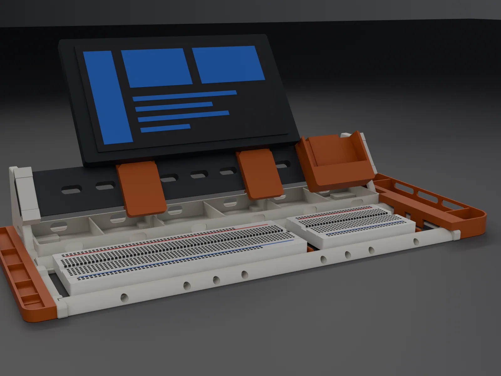
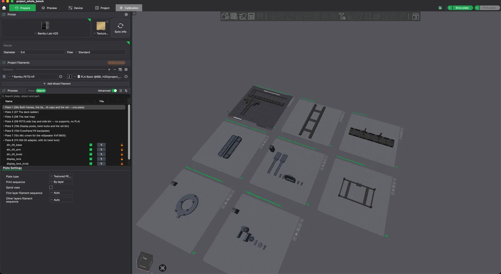
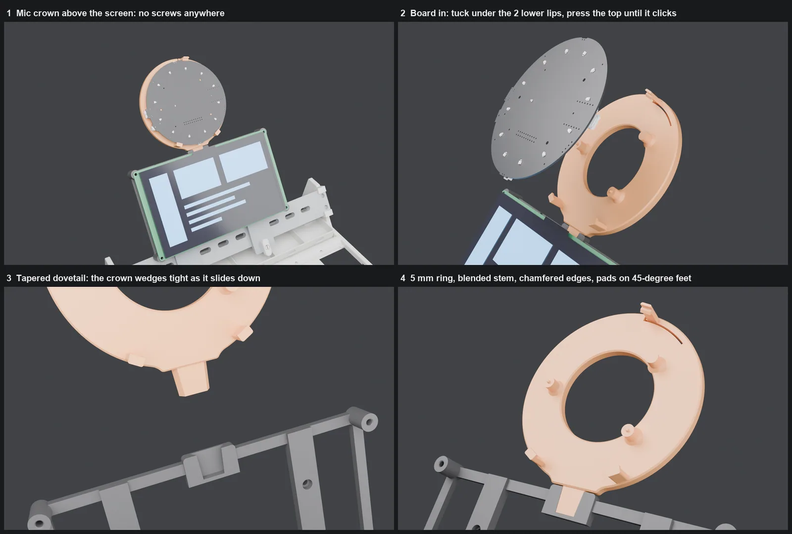

# Breadboard Bench

A 3D-printed electronics workbench: two breadboards in a cradle, a DIN rail across the back
for clip-on modules, a 7" touchscreen on posts, and a mic array above it. Every part is
Python code, checked by scripts before a gram of plastic is spent, and written out as
finished Bambu Studio projects.



- **See it:** [the build hub](https://redding.digital/bench-hub.html), with a 3D viewer,
  catalogue, schematics, films and the build storyboard
- **How it was made:** [the "How I made this" page](https://redding.digital/bench-hub.html#made)

## Print it

1. Open `out/plates/project_whole_bench.3mf` in Bambu Studio: every PLA and PETG part on eight
   plates, about 19 hours. Slot 1 is PETG HF, slot 2 is PLA Basic. Plates 7 and 8 are
   **optional add-ons**: the mic crown (for a reSpeaker XVF3800 above the screen) and the DIN
   tilt adapter (for DIN devices too tall for the raked rail; it takes the rail bin's place).
2. Print `out/plates/07f_tpu_feet_all.3mf` for the 18 TPU feet (37 min).
3. Print plate by plate: click a plate, Slice plate, Print plate. Map the filaments in the
   Print dialog; pressing Sync info resets the project's filament settings.
4. Plate 4 pauses twice for magnets. `out/plates/PLATES.md` has every plate's hand steps.

Hardware: 14 x M3x12, 4 x M3x8, 4 x M3x16 and 1 x M3x20 socket head screws, 9 M3 hex nuts,
17 N52 6 x 2 mm magnets, 8 O-rings (3 mm ID, 1 mm section), a full and a half breadboard,
an Elecrow CrowPanel Advanced 7" ESP32-P4, and optionally a Seeed reSpeaker XVF3800.



## How it is made

- **Measure:** every size lives in `cad/params.py`, from calipers, the vendors' 3D models,
  or small test prints that settle one number each.
- **Build:** `cad/bench.py` and `cad/frame.py` turn those numbers into parts with
  [build123d](https://github.com/gumyr/build123d) and save STL and STEP files.
- **Check:** `check.py` (printable), `screws.py` (screws and snap-fits),
  `assembly_fit_check.py` (every part goes on without hitting anything).
- **Plates:** `plates.py` writes the Bambu Studio projects, and Studio's own slicer
  confirms each one.
- **Render:** Blender makes the pictures and films (`render.py`, `render_catalog.py`).
- **Publish:** `catalog.py` and the viewer scripts build the hub; `publish_site.py` makes
  the public copy.

## Build it yourself

```sh
python3 -m venv ~/.venvs/breadboard-bench
~/.venvs/breadboard-bench/bin/pip install build123d trimesh manifold3d numpy pillow
cd cad
python bench.py            # parts -> out/stl, out/step
python frame.py            # the assembled bench -> out/frame
python check.py            # printability
python screws.py           # screws and snap-fits
python assembly_fit_check.py
python plates.py --verify  # Bambu Studio projects, sliced through Studio's CLI
```

Tested with Python 3.14, build123d 0.13, trimesh 5.1 and Bambu Studio 2.8 on macOS.
The vendor models are optional; `ref/README.md` says where to get them.



---

# Design notes

> **Two variants exist.** `cad/bench.py` builds the **console** — a solid tiered
> tray, 253 g. `cad/frame.py` builds the **frame** — a skeletal chassis, **133 g**,
> which is where the design ended up after "everything is so thick."
> Read *The frame variant* below first.

## The frame variant

The console is a solid tray doing four jobs at once: holding breadboards,
storing parts, supporting the panel, and providing the footprint. That is *why*
it reads as a block — one mass has to be thick enough for the worst of those
jobs everywhere, so it is over-built almost everywhere.

The frame separates them:

| | Console | Frame |
|---|---|---|
| Structure | 308 cm³ solid body | 2 end frames + a deck ladder + a tie + a tray |
| Filament, structure only | 186 g | **92 g** |
| Filament, with modules | 253 g | **133 g** |
| Breadboard positions | two fixed wells | a continuous 55.4 mm cradle |
| Parts storage | five moulded bins | six sealed cells + clip-on, on the rail |
| Loose parts | none | **none** (Mk3; Mk2 had three) |

**The DIN rail stops being a passenger and becomes a structural member.** In the
console it was screwed to a 288 × 70 panel that existed only to hold it — and
that panel was the single heaviest feature at ~84 cm³. In the frame the rail
ties the two end posts together directly, so the panel simply disappears.

```
end frame ×2   the shape: foot bar, raked post, braced, then lightened
deck ladder    both half-round cradle rails + three deck plates over the
               foot stations, one flat print
din rail       structural tie AND the module mount
rear tie       stops the frames splaying
rear tray      six cells; grows two integral buttresses that back the DIN
               rail at X=100/200. Its rear wall seats on the tie rod along
               the whole 288 mm — no tails, no gap. Every
               cell has a 13 x 7 wire passthrough in BOTH long walls, so
               a board can live in a cell with leads out the front to the
               deck and power out the back of the bench
rail pad ×4    TPU gasket keeping every rail joint preloaded
foot pad ×18   TPU feet: 6 under the ladder, 4 under the frames, 4 under
               the rear tray, 2 under the side bin, 2 under the left screw
               tray -- the whole bench stands on one Z=-1 TPU plane
```

**Hardware: fourteen M3 screws — six ×12 socket head cap, eight ×16
countersunk — and nothing else.** Both are ordinary metric fasteners: they
self-tap into Ø2.5 printed pilots without being self-tapping screws, and the
bite is the annulus between the Ø3.0 shank and the pilot. Each kind is
forced by geometry, not preference: the eight rail screws are countersunk
flush in the rail's outer face (the face the clips slide on — a raised head
there sat in every module's path), and they are ×16 because the printed rail
is solid to 7.5 mm at the centreline, so a ×12 left only ~4 mm of bite in
the post. Their heads must be the **90° form (DIN 7991 / ISO 10642)**, not
the 82° US-sourced one: the recess is a true 90 cone, so an 82 head touches
only at the rim and wedges. The six bar-end screws keep a raised head
because a countersink there broke through the plate's bottom edge (the tie's
screw line sits only 3.15 mm above it) — and it is a **socket cap head,
ISO 4762, Ø5.5 × 3.0**, not a pan head: every head pocket in the bin and the
trays is cut to `BAR_HEAD_T = 3.0`, which is that head exactly, and the
modules hang off those heads magnetically (see *Print notes*). In
every joint the pattern is the same: Ø3.2–3.4 clearance in the near part,
Ø2.5 pilot in the far one, so the screw clamps rather than locates — the
sockets and shoulders do the locating. The screws are modelled as props, so
the viewer and renders show them where they land.

A note the closed crown earns: a steel top-hat is open over its web, so its
slots are visibly through-holes. The printed rail keeps a solid crown for
stiffness — it is a structural tie, not just a mount — so its 25 mm slots
and mount bores are drilled through the full 7.5 mm section. For one
revision they were not: the cutter was sized for the web alone and every
hole was sealed under a 0.2 mm skin, with the screw recesses buried
mid-solid — geometry that measured clean in every interference sweep and
could never be assembled. Through-ness is now ray-tested, not assumed.

**Mk3: the hosts absorbed their guests.** Mk2 had two `rail_strut` blades
passing *through* the rear tray (slots cut in its wall and dividers, which
read as cheap notches and opened two cells to the back) and two loose
`cross_rib` chips that merely rested between the deck rails — and sat 1 mm
below the board line once the TPU feet lifted everything else, a shim
supporting nothing. Now the tray's own dividers thicken to 6 mm at the two
rail stations and continue upward as buttress blades — strut, divider and
tray wall are one moulding, so there is nothing to cut a slot for, and the
rear wall is sealed again. The rails and ribs merged into one flat-printed
deck ladder, which locates the deck plates positively. Zero loose parts remain.

The rail is still backed by four coplanar faces (two frames, two
buttresses): free spans of 91/94/91 mm against an unsupported 288, a
(288/94)³ ≈ 29× stiffness gain. Each buttress is braced across X by the
tray box itself — 288 mm of closed 1.6 mm walls is the shear panel, and
above the rim the blade is a fixed-root cantilever ~30 mm tall
(I = 25·6³/12 ≈ 450 mm⁴, so 20 N sideways at rail height moves the land
~0.17 mm). A module shoved onto the rail now goes as near-pure compression
down the blade, through a thickened floor boss, into a TPU foot on the
desk — a load path Mk2 never had, since strut and tray both hovered 1 mm
above the desk with no foot of their own.

**The rail clicks into the frames.** Each end frame's land carries a full
profile mortise — the rail's own grown top-hat section subtracted straight
through 12 mm of shroud — so the rail end slides in along its length and is
captured by shape on every other axis, the same spigot-in-socket grammar as
the round bars. The roof is windowed over the web to keep the screws
reachable, which leaves an L-cheek wrapped over each lip: the carriage-on-a-
slide-rail section, replacing Mk3's shoulder rib and single small hook. A
0.05-bite detent lens in each down-slope cheek gives a tactile click as the
lip cams past, and holds the rail against sliding back out before the
screws go in. (`DETENT_BITE` was 0.15 for one revision. The DFM review
measured the stack rigid enough that 0.15 ploughs rather than clicks —
which is why the fix is always the bite literal, never opening
`RAIL_FIT_MORTISE`.)

**Assembly order** (everything engages along X, in one direction): deck
ladder and tie down → tray lowered straight onto the tie, where its rear
wall's full-length conforming seat takes the rod (free in X, so 288 mm of
print shrinkage cannot bind) → rail threaded through both buttress stations → frames slid
on, bar spigots and rail mortise engaging together, until the rail clicks →
screws, two per frame and two per buttress → modules clip on last. The
tray's feet start 0.1 mm shy of the frame-foot plane so differential TPU
squash cannot tilt the buttress lands; the rail gaskets absorb the
difference.

**A truss made of holes, not of struts.** Each end frame is drawn as one closed
profile and extruded — a single stiff plate — and the mass comes back out as
windows. That prints far better than an assembly of struts: no joints, no stress
risers, and every edge is vertical in the print.

**The cradle is continuous, which the console could not be.** Two L-section rails
55.4 mm apart run the full width, so a full-size board, a half-size board and a
parts tray sit anywhere along it in any combination. The console had to commit
to well positions.

**Why the rails can be half-round R8.** The TPU feet under the rails at
X = 52/144/236 cap every vertical span at 92 mm — deflection goes with span
cubed, and a 20 N press at mid-span sags ~0.18 mm on a 92 mm span
(I ≈ 450 mm⁴ for the half-round). That is what let Mk2's loose cross ribs
die: the desk itself is the mid-span support. Between the rails, three
20 mm **deck plates** sit one over each foot station, tops coplanar with
the ledges at Z=3: a board pressed hard at centre bears straight down
through a plate onto a TPU foot. (They replaced two R3 half-round rungs
that were honest about being mere see-saw insurance and looked it.) The
ledges themselves are 4.5 wide, giving each board edge **3.0 mm of
bearing** — the 1.5 mm of the first cut was a knife-edge that shrink and
board tolerance could have halved; the extra width came out of the cradle,
so the rail axes never moved.

Three bugs worth recording, all caught by looking rather than by reasoning: the
rail-seat pocket was cut with post-frame boxes 80 mm long in X and ploughed a
groove clean across each plate; the rail was built at `SPAN - 2`, which
stopped 1 mm short of each frame and made it a beam supported by nothing; and
for two whole revisions the ladder and tie were built at `SPAN` exactly, flush
at the mouths of sockets cut 3.5 mm deep — the socket opening is r+0.2, bigger
than the bar, so the end faces bore on air and the deck was located axially by
screw shanks alone. The exploded viewer is what exposed it: a socket and a bar
end that never meet read wrong the moment they separate. The bars now carry
`ENGAGE = 3.0` mm spigot ends into the sockets, leaving 0.5 mm of end float as
the shrinkage allowance the screws take up, and the deck rails' ledge end
faces become the shoulders that butt the frame.

---

## The console variant

A 3D-printable prototyping bench for breadboards, ESP32 / Raspberry Pi boards,
and LCD / e-ink displays. Hybrid of the two references: a tiered console body
(like `Brea_bored_holder_V4`) whose raised back panel carries a printed
TS35 DIN rail (like `proj`), so displays and boards clip on and swap freely.

**Overall: 300 × 134 × 92 mm.** Fits the Bambu H2S plate (340 × 320 printable) in one piece.

## What the bench is made of

| Part | Size | Vol | Est. filament | Print pose |
|---|---|---|---|---|
| `base_body` | 300 × 134 × 91 | 304 cm³ | ~186 g | As modelled, base on the bed |
| `din_rail` | 276 × 35 × 7.5 | 53 cm³ | ~26 g | Flat, LIPS on the bed, web up (flipped 2026-09-19) |
| `board_plate` | 78 × 68 | 16 cm³ | ~11 g | **On edge** |
| `screen_bezel` | 92 × 52 | 19 cm³ | ~10 g | **On edge** |
| `rail_bin` | 58 × 46 × 22 | 14 cm³ | ~10 g | **On edge** |
| `breadboard_carrier` | 91 × 61 | 18 cm³ | ~11 g | **On edge** |

**Print the clip-on modules on edge, not face down.** The sprung jaw is a
cantilever whose beam axis runs along the module's local Z. Printed face-down
that axis is vertical, so the layers stack *across* the beam and every snap-on
cycle loads the interlayer bond at the jaw root in pure tension — which is the
standard way printed snap-fits shear off, typically within 5–20 cycles. On edge,
the same stress runs along the layers. Face-down gives a nicer visible face; it
is not worth a clip that snaps. If you want both, split the clip into a separate
part and bolt it on.

Everything is watertight and support-free apart from two accepted overhangs, both
short-span: the four 14 mm felt-pad dimples 0.8 mm above the bed, and, until
2026-09-19, the eave under each rail lip. That eave was accepted on the grounds that
it "droops slightly on a surface nothing touches" — true of the console, false of the
frame variant, whose mortises slide on exactly that surface: plate 02's `rail_stub`
sagged strands off both lips and jammed every slot. The rail and its stub now print
lips-down (`PRINT_POSE` in `cad/check.py`), where the section only narrows going up
and there is no eave at all.

Run `python cad/analyse.py` to regenerate these numbers and see where the mass
sits. It slices the base body into depth and height bands, which is how the
slimming pass below was targeted.

## Slimming pass

The first version was 467 cm³ / ~300 g. Measuring first showed 42% of the base
sat in the bottom 10 mm (the floor slab) and 58% behind Y=100 (the panel and its
buttress) — so those got the attention and the already-thin features were left
alone.

| Change | From | To | Saved |
|---|---|---|---|
| `FLOOR` — a 300 × 134 plate, the heaviest single feature | 3.0 | 2.0 | ~40 cm³ |
| Bins run the full tier depth instead of sitting between solid ledges | 24 mm | 30.4 mm | ~55 cm³ |
| `PANEL_T`, paired with tighter gusset spacing | 5.5 | 4.0 | ~30 cm³ |
| Rear wall starts its taper lower | 30 mm | 12 mm | ~22 cm³ |
| `BIN_WALL` | 4.0 | 2.8 | ~5 cm³ |
| Gussets: five 5 mm ribs replacing four 8 mm ones | 32 mm | 25 mm | ~10 cm³ |

**467 → 315 cm³, about −33%.** The panel got *stiffer* while getting thinner:
deflection goes with span cubed, and dropping the gusset spacing from 88 mm to
68 mm buys more than the 1.5 mm of thickness gives up.

Deliberately **not** slimmed: the DIN rail profile (dimensionally fixed by
TS35), the clip jaws (they need section to spring without cracking), and the
2.4 mm bezel face. Note that solid volume is not filament — a 2 mm wall prints
~100% solid while a thick block gets hollowed by infill, so thinning already-thin
features pays roughly 1:1 while thinning thick ones barely registers.

## Layout

- **Front bay** — two recessed wells: a full-size 830-point board (165.1 × 54.74)
  and a half-size 400-point board (83.0 × 54.74), 8 mm deep so a 9–10 mm board
  sits ~1.5 mm proud. Finger scoops in the rear wall pop them out. A rounded
  trough at the right end takes probes, tweezers and snips.
- **Middle tier** — five bins, 23 mm deep, with a scooped front lip.
- **Back panel** — leans back 20°, carries the DIN rail at 38 mm up the face.
  Three cable pass-throughs run below the rail; the buttress behind is hollowed
  between three gusset ribs.

## The printed DIN rail

**It took three attempts to get the section the right way up.** Worth writing
down, because the first two were confidently wrong in the same way.

A clip jaw hooks *under* the rail's outer edges, so those edges need air behind
them. Versions 1 and 2 both laid the 35 mm span flat against the panel and stood
the 27 mm section proud — backwards. On a real EN 60715 top-hat the **27 mm web
lies on the mounting face** and the **35 mm lips stand 7.5 mm off it**, leaving a
6.3 mm channel behind each lip for the jaw to swing into. That is also *why* the
mounting slots are in the web: the screws pass through the flat part that touches
the panel.

Getting it backwards had knock-on costs. V1 bolted a 1.5 mm standoff spine to the
underside to fake the channel, which left the lips cantilevered in mid-air 1.5 mm
above the bed. V2 moved the clearance into a groove milled in the panel — which
printed beautifully but meant **no commercial DIN accessory could engage it at
all**, because a clip presented to it meets 27 mm where it expects 35.

The current section is a true top-hat. The channel comes for free, the panel
groove is gone, and a £3 steel TS35 offcut is now a drop-in replacement.

**Compatibility is still not promised, and that is deliberate.** Holding EN 60715's
35 mm −0.3/+0 width tolerance in PLA is not realistic — a 0.4 nozzle typically
lands +0.1 to +0.2 per side, on the side that stops clips closing. And spring
steel jaws exerting 20–50 N on a sub-mm² contact patch will emboss PLA and creep
PETG. Model at 34.7 and measure if you care. The honest position: this is a
proprietary clip system that keeps the TS35 footprint as an escape hatch.

## Board plates are dedicated now — one per board family

The universal cruciform plate is gone, killed by a measurement rather than a
principle. Its scheme was screw-through-slot with a nut behind, and the
plate's back lies flat on the rail's closed crown: every hole position over
the rail band (|y| < ~18) had nowhere for the nut to exist. A Pi 4's outer
holes cleared the rail's edge; the ESP32 the plate was named for could not
be bolted on at all. No gate caught it because no gate ever checked
fastener access against the mounting surface — `screws.py` audits that now,
for the bench's own screws and for these plates.

Dedicated plates dissolve the problem instead of solving it. Each board's
holes are *known*, so the plate grows a Ø7 × 4 mm standoff boss under each
one and an **M3 × 8 self-tapper goes straight in from the front** — no
nuts, no back-side hardware, and the clip seats exactly as before. The 4 mm
standoff is also where a DevKit's underside pin headers live. Bosses are
gabled on the print-down side (the teardrop trick), and each pilot stops
0.6 mm above the back face: a proud screw tip would hold the clip off the
rail lips, which is the same failure the nuts had — the audit checks both
depth and back-skin on every pilot.

| Plate | Patterns carried | Boards |
|---|---|---|
| `board_plate_esp` | 45.5 × 22.0 | ESP32 DevKit v1 (DOIT) |
| `board_plate_pi` | 58.0 × 49.0 and 58.0 × 23.0 | Pi 4, Pi 3B+, Pi Zero |

A new family member is a three-line entry in `BOARD_SPECS` (params.py) —
pattern, plate size, done. The cruciform's one durable lesson is recorded
here so it is not relearned: parallel slot rows cannot mount arbitrary
boards at any pitch (a slot gives freedom along itself, not across), and
crossed arms fix that on paper — but a mounting scheme is only real if the
fastener can be *installed*, not just drawn.

## The universal display mount — open frame, any hole pattern

The one place a universal mount IS the right answer: displays. Boards have
a handful of known families; displays arrive in every size with every hole
pattern, and a bezel per display means a new print per purchase. The mount
is an open H-frame — nothing covers the display face — currently shown in
the assembly views carrying a 7" Elecrow CrowPanel (180 × 105, ~450 g):

- **Spine** (`display_spine`): a plate on **two** clips (450 g wants a
  couple, not a pin) with four gabled bosses — the uprights screw to it
  front-entry, M3 × 12 self-tap, the dedicated-plate idiom, because these
  four holes are known and known holes need no nuts
- **Uprights** ×2 (`display_upright`, one STL printed twice — the −90°
  placement of the second maps its lines to the mirrored positions). They
  mount **off-centre**, riding 33 mm above the rail: centred bars speared
  27 mm through the deck (the rail sits only 38 mm up a deck-level face).
  Four fixed holes — the engaged pair plus its mirror — keep the part
  symmetric, and flipping a bar 180° hangs a display *below* the rail
  instead of above it
- **Crossbars** ×2 (`display_crossbar`): the display screws to these from
  the front, through its own mounting holes

Adjustability is T-slots with **captive M3 square nuts** (DIN 562,
5.5 AF × 1.8): crossbars clamp anywhere along the uprights (vertical hole
pitch 0–110), display screws land anywhere along the crossbars (horizontal
span up to 168). This honours the cruciform's epitaph *by construction* —
every nut channel stands 11+ mm proud of the rail band, so there is nut
access at every position of every slot, and slot line and crossing-hole
line sit on **offset centrelines**, so a display hole can never collide
with a crossing screw and both slots run unbroken. Crossing holes are
counterbored: a proud pan head would hold the display off its clamp face.
The bars print **flat** so both slot widths are bed-quality — slots
printed across layers bind (the board-plate X-arm lesson). screws.py
audits the spine bosses; the crossings were ray-verified in the placed
assembly.

**Mount v2 — two clip-on posts (`display_post`). ADOPTED; this is what the
frame ships.** The H-frame's spine exists only to hold the uprights, and
the crossbars only because the uprights sit at a fixed spacing. The rail
already solves both: a post is a T-slot bar with its own clip at the foot,
and you clip two on at whatever spacing the display's holes need — X from
the rail, Y from each post's slot. One part printed twice; from behind the
screen shows two thin posts and nothing else. The foot flares to the clip
plate's 30 mm (post and clip read as one piece, and it stands on a real
face printed on edge).

| | parts | volume | PETG | mount screws |
|---|---|---|---|---|
| v1 H-frame | 5 | 63.4 cm³ | ~81 g | 8 × M3 × 12 |
| **v2 posts** | **2** | **25.1 cm³** | **~32 g** | **none** |

60% less plastic, three fewer parts, and the eight M3 × 12 that existed
only to bolt the mount to itself are gone — the only screws left are the
two to four that fasten the display itself. Nothing remains whose job is
to hold other parts of the mount.

`display_mount_placed()` still builds v1 and is still imported;
`python cad/display_mount_v1.py` stages it as a full frame assembly in
`out/frame_mountv1`, so the hub's viewer keeps **Mount v1** selectable
against the current build. (This is the old `display_posts.py` turned
around — that script staged v2 while v1 shipped, and staging the shipped
design as a variant of itself would be a no-op, so it was deleted.)

**Assembly order matters now.** The posts' 30 mm clip plates sit over the
four buttress rail screws at X=100/200, and with the mount centred at 138
inside the usable 48..228 rail span there is *no* post spacing wider than
120 mm that clears both stations — so drive those four screws before
clipping the posts on, and unclip a post to get at one later. `screws.py`
treats it as a soft note rather than a blocker for exactly that reason;
each post unclips on its own, where v1's five pieces had to come off as one
unit via the spine.

**Still to check before printing:** each post has one continuous
through-slot 82 mm long (z 26–108). A display whose vertical hole pitch is
under 82 mm gets two screws per post and is fully constrained; above that
only one screw per post lands, leaving the panel able to pivot about the
line through them — which matters with 450 g on it. Measure the CrowPanel's
pitch; if it is over 82, lengthening the slot is a constant, not a redesign.

**Prototype swap, not a purge:** while the mount is trialled, the board
plate and screen bezel are off the rail in the assembly views (the mount
spans 48..228, their old stations). Their parts still build and export;
re-placing them is one line each in bench.py and frame.py.

## The side bin — a trough that hangs on nothing

A long, low parts lip (160 × 34 × 14.5 — the rear tray's own height and
1.6 mm gauge, so the two storage rims read as one family) for the frame's
right face. It stands on **its own two TPU feet** (the standard pad in the
standard pocket, level with the frames on the bench's own stance), drops
straight down over the deck band, and **snaps on magnetically**: three N52
Ø6 × 2 discs pressed into its back wall sit 0.9 mm off the three black-oxide
alloy-steel bar-end cap heads. Self-centring, silent, nothing visible, nothing
cut into the frame. The continuous rolled return over the band's 8 mm top
edge locates it and backs the magnets up mechanically; lifting straight
off shears the magnets free — that is the removal gesture. The discs press
in from the cavity side and their own pull seats them against a 0.6 mm
skin, so they can never migrate toward the frame. Consequence written into
the BOM: the bar-end screws are **black-oxide alloy steel (ISO 4762 socket
cap)** — plated mild steel grips several times weaker, and stainless is
barely magnetic at all. Confirmed by test on 28 Aug: an N52 disc snaps hard
onto the cap head. (History: this replaced a hook-slide-click of
T-studs in frame-cut J-slots that the workflow had verified sound — but it
was four features doing one job and it notched the frame's clean face. One
mechanism, reusing steel already there.) The front
corners sweep at R15 — a stadium nose, chosen from rendered form studies
(vs a flared wall and a truss-windowed wall) — so the tray reads as a
scoop flowing around the bench corner rather than a box parked beside it. The structural screws are never touched —
nothing rides in their clamp path. screws.py *measures* the promise on
every build: ≥ 0.25 mm clearance around each head, and a ray test that
each head is actually hidden. Left-side twin when wanted:
`mirror(side_bin(), Plane.YZ)`, the end-frame rule.

## Board width — settled by caliper, 2026-08-28

A real MB-102 (StellarSource) measures **54.74 mm** across, not the 54.4 this
model started from. That put a board's edge at rail-local 9.33 against a tooth
strip ending at 9.30 — **0.03 mm**, i.e. resting on the teeth. Precisely the
"wonky board" failure the serration was drawn to prevent, and it would have
shown up only after the 87 g ladder was printed.

`TOOTH_Y1` is now derived rather than hard-coded:

```python
BB_D_MAX = 55.2                                    # widest board in service
TOOTH_Y1 = (REAR_AXIS - FRONT_AXIS) / 2 - BB_D_MAX / 2 - 0.2
```

| board | edge at | clear of teeth |
|---|---|---|
| 54.40 (old assumption) | 9.50 | +0.60 |
| **54.74 (measured)** | 9.33 | **+0.43** |
| 55.00 (datasheet) | 9.20 | +0.30 |
| 55.20 (ceiling) | 9.10 | +0.20 |

`CRADLE` is pinned at 48.4 instead of tracking `BB_D`, so the rails, tie, tray
and every head-pocket station stayed exactly where they were. A wider board
only gains ledge bearing — 3.17 mm a side instead of 3.0 — which is free. The
strip narrows 1.7 → 1.3 mm; the deck stop's feet derive from the same
constants, so they followed automatically.

Datasheets quote the MB-102 at 55.0 and one vendor at 54, which is why the
caliper is the authority.

**Then the second measurement made the first one nearly irrelevant.** The far
end of the same board reads **54.80**, and chasing that revealed the real
problem: a board has **1.88 mm of free front-to-back play** and nothing
locates it, but only **0.40 mm** of that before an edge climbed onto the
proud teeth. The likely trigger was never a wide board — it was nudging one
while pushing in a wire. More tolerance made it *worse*, because widening the
ceiling pushes the tooth line further toward the rail, and the strip already
starts 0.18 mm off the arc.

**So the serration is now recessed.** `deck_rail()` cuts a `TOOTH_H`-deep
trench in the shelf and puts the teeth back inside it with their tips flush
at `LEDGE_Z`:

```python
rail -= box(0, SPAN, ty0, ty1, LEDGE_Z - TOOTH_H, LEDGE_Z + 1.0)
rail += teeth(0, SPAN, ty0, ty1, z=LEDGE_Z - TOOTH_H)
```

The shelf is now continuous flat, so a board can sit **anywhere** across the
cradle and at worst bridges a 1.3 mm slot — it cannot be lifted at all, and
board width stops being a failure mode rather than merely being toleranced.
The stop's feet hang *into* the trench instead of straddling proud teeth:
same 2 mm indexing, inverted, and the mating profile is still cut with the
ledge's own `teeth()` so the two can never drift apart. Verified by clash
probe — both stops intersect the ladder by 0.000 mm³.

Feasible because the ledge is 2.95 mm thick through the strip zone, so a
0.9 mm trench leaves 2.05 mm underneath. Cost: 0.7 cm³ off the ladder, and
the stop grew 4.0 → 4.8 mm tall.

One thing this caught on the way: the stop's body used to end at
`TOOTH_Y0 - 0.2`, which is 0.02 mm *inside* the rail arc at board height. It
now ends 0.2 outboard of the trench with 0.38 mm of daylight.

## Serrated ledges and deck stops — boards that stay put

Each ledge carries a 2 mm-pitch, 0.9 mm serrated **strip** along its outer
1.7 mm — the sliver between the rail's arc and the board's edge, never
under the board, so the boards still sit on a flat 3 mm shelf. A **deck
stop** (a 2 × 4 PETG bar with a toothed foot at each end — a lip, not a
wall) drops in behind any board and is
positively located to the pitch: a shove along the rail meets tooth flanks,
not friction. Nothing to spring, turn, or lock; infinitely re-positionable
in 2 mm steps; works for any board length or combination. Chosen from five
rendered concepts (spring stop, gate pegs, TPU grip pads, cam divider) —
the serration costs nothing because it prints flat and upward, and it reads
as a fine line along each rail, like the truss-of-holes. The stop prints
on its side so its 42° tooth flanks are walls, not overhangs. Both strips
share a phase (`teeth()` starts on whole pitches from x=0), so a stop's
feet land on both at once; the strips run the full length because that is
what "a stop anywhere" costs.

## Rail caps — the last visible screws

The mortise shroud's roof is windowed over the rail's web band so the two
M3 × 16 countersunks at each end can be driven; their heads sit flush in
the rail's top face, 2.45 below the roof line. A **rail cap** drops into
that window with its top flush to the roof, so the shroud reads as one
solid socket. Two N52 discs in its underside sit directly on the steel
heads it hides — it pulls itself down onto the screws. Nail under the edge
to lift it for service. Same bone PLA as the frame, 100% infill (it is
mostly skin), printed top face down so the 0.45 skin over the magnets is
bed-solid. Consequence for the BOM: the rail screws are carbon steel, not
stainless. (The four mid-rail screws at the buttresses stay flush and
uncovered — that face is the clip slide path — and are hidden by whichever
module sits there.)

## The left screw tray — hiding the other three heads, and sorting screws

The bin hides the right side's bar-end heads; the left gets a **screw
tray**: the bin's small sibling at half the width (17.9) and half the
height (8), no feet — it hangs on the three head magnets 1 mm off the desk
and lifts straight off to service the screws. Five compartments of three
sizes (22 / 22 / 30 / 30 / ~47 mm) for sorting, each with an N52 disc
flush in its floor so the screws stay where they are dropped. Semicircle
nose, so it reads as family.

**Installing magnets** (17 per bench): every pocket is modelled Ø6.25 and
prints ~6.0–6.1 — a light press for a Ø6 disc. Every pocket faces the
direction the magnet is pulled *away* from, so its own working pull seats
it deeper: cell discs press in from **underneath** and sit under a 0.6 mm
floor skin (nothing shows inside a compartment; a screw's pull drives the
disc up against the skin); back-wall discs go in through the head pockets
from the bench side (mounted, their pull sandwiches them against the steel
head); rail-cap discs sit in the cap's underside against the screws. None
## Cell magnets are pause-and-insert — pause at Z = 3.2 mm

The seven cell discs (2 in the side bin, 5 in the left tray) are no longer
pressed into the underside. Their pockets open **upward** and are **sealed by
the print**: pause, drop the discs in, resume, and the next layers roof them
over. No press fit to get right, nothing that can fall out of the underside,
no glue.

1. Slice `side_bin` and `side_tray` **at 0.2 mm layers**. This is not
   optional: 3.2 ÷ 0.2 = 16 layers exactly, while 3.2 ÷ 0.28 = 11.43, so at
   0.28 there is no layer boundary at the pause height and you would stop
   either before the pockets open (3.08) or after the roof has started
   (3.36). The 0.28 recommendation elsewhere is for the **rear tray only**.
2. Set **Support → "On build plate only"**. The pockets are sealed voids;
   support set to "everywhere" — tree support especially — can colonise an
   internal cavity, and you will not find out until the magnets refuse to
   seat. After slicing, drag the preview to layer 16 and confirm seven open
   holes with nothing in them.
3. Add a pause at **Z = 3.2 mm** on both (same height on both parts, by
   design — `MAG_PAUSE_Z` in frame.py).
4. Drop one N52 Ø6 × 2 disc into each open pocket. Fingers only.
5. Check each one is **below** the surrounding surface before resuming. It
   should be — the pocket is 2.2 deep for a 2.0 disc, so a seated disc sits
   0.2 mm proud of nothing.
6. Resume.

Two rules make the pause safe, and both are geometry rather than care:

- **The disc sits 0.2 mm below the pause plane.** The nozzle never sweeps at
  disc height. This matters more on an H2S than on older machines: it ships a
  **hardened steel nozzle**, and unlike brass that is ferromagnetic — a proud
  N52 disc has a reason to jump to it.
- **The disc is buried, not surfaced.** 1.0 mm of floor under it, 2.2 of
  pocket, then 0.8 (tray) or 1.3 (bin) of seal over it. The tray's seal was
  0.6 — three layers, the thinnest sealed span in the build and the only
  thing between a screwdriver and a magnet. It gets a fourth for 0.6 cm³.

Keep the chamber at 0 for these prints. N52 is the most heat-sensitive
neodymium grade — it starts losing strength permanently around 80 °C — and
the H2S can actively hold 65 °C.

Burying the discs also puts them ~0.8 mm closer to the screws they hold
(1.7 mm of plastic, against 2.5 when they went in from below), so they pull
harder than the pressed-in version did.

The six **back-wall** discs are unchanged: they go in sideways through the
head pockets and end up sandwiched between the skin and a steel screw head,
captive by assembly. The four **rail-cap** discs stay a press fit — the cap
is only 2.45 mm thick, so there is nothing to seal them under. Neither


**All seventeen are in the 3D viewer** (`magnet_discs()` in frame.py), in the
*M3 screws* group so they toggle with the steel they grab. They are bought
hardware, so they go into the assembly dict only — never into the printable
parts — and the gates and build sheet are untouched. Each disc is built in
its host part's own local frame and then given that host's exact placement
transform, so it cannot drift from its pocket when a host moves; a probe
confirms all seventeen sit in a void with zero intersection against their
host, which is what catches a disc modelled into solid plastic.

If you ever do
reach for the iron, touch only the plastic rim; N52 loses strength for
good above ~80 °C. Do not pause-and-drop mid-print: a disc sitting proud
meets the nozzle. (Why not counterbore the heads into the plate: the screw line is
3.15 above the plate's bottom edge, the R6 tie rod cannot take a higher
pilot, and the rear station sits inside a lightening window — and a
counterbore still shows the screw. Apple hides fasteners under magnetic
covers, not in holes.)

## The tie seat — the wall lands on the rod, and the tails are gone

The two buttresses used to end in a tail: a 6 × 18 × 11.5 slab with a 45°
V cut in it, apex at `TIE_R·√2` so both faces were exactly *tangent* to the
R6 tie rod. Two line contacts, 6 mm long, per station.

Restyling that tail was the wrong problem. The real offence was one line up:
`TRAY_Y1 = TIE_Y − TIE_R − 2.0`, which left a **2 mm slot running the whole
288 mm** between the tray's rear wall and the rod. That slot is the gap the
eye reads, and the tails existed only to bridge it — which is why every
attempt to make them elegant still looked like a bracket bolted on the back.

So the wall now lands *on* the rod:

```python
TIE_FIT  = 0.15
TRAY_Y1  = TIE_Y - (TIE_R + TIE_FIT) / math.sqrt(2.0)     # 144.65
```

**How far back the wall may come is set by the printer, not by taste.** The
tray prints upright, so the wall's underside may not exceed 45° — and 45° is
exactly the rod's tangent point. The constraint hands over the design line.

The seat itself is cut with the rod's own section grown by `TIE_FIT`, swept
the full width, as the last operation in `rear_tray()` so the buttress roots
get it too. Cutting the mating part rather than modelling a socket means the
seat is conforming by construction: there is no socket geometry to keep in
sync with the rod, and no fit to get wrong beyond the one number.

| | contact | tray | rim | support area |
|---|---|---|---|---|
| V tails | 21 mm² | 48.5 cm³ | — | 1372 mm² |
| **tuck** | **1340 mm²** | 49.6 cm³ | +3.65 mm deeper | **1033 mm²** |

Contact up 64×, one fewer feature, and it prints *better* than the tails did
(they were the over-45° offenders). The tray moving back with the wall gains
3.65 mm of depth across all six cells, so most of the material comes back as
storage.

Both joints are selectable in the hub's 3D viewer — **Frame** is the tuck,
**Tie v1** is the superseded V-tail build, so the change can be judged rather
than taken on trust. frame.py no longer contains that geometry; the variant is
staged by `scratchpad/stage_tievee.py`, which rebuilds it from the retired
constants and is verified faithful by volume (48.52 cm³, the original figure).

**Open point — the tie's cable bores.** `rear_tie()` carries a 2.8 mm bore
every 24 mm at z = 3.0 for cable ties, and those bores exit the rod's front
flank at y = 143.80 — inside the band the wall now occupies. Measured: about
0.5 mm of each 2.8 mm mouth survives, so they are effectively blocked. The
seat and the bores cannot both exist at that height; relieving the wall
enough to clear them would remove most of the bearing. Recommendation is to
drop the bores (`holes=None` in `rear_tie`) and route cable at the tray's own
13 × 7 passthroughs and the ladder's holes — not yet done, since it changes
what a different part is for.

## Why it no longer reads as a block

The first version was three orthogonal masses in one colour, a 3 mm corner
radius, and not a single edge that caught a highlight — so the eye resolved it
as one lump. The fix was four subtractions, for **+3 cm³ net**.

**Stop composing it as three masses and compose it as two.** The vertical rhythm
is 10 / 15 / 66 mm: the first two are so close that they read as one 25 mm base
with an accidental step in it, and the panel reads as a fin bolted to a slab.
Those numbers are functionally locked (8 mm well + 2 mm floor = 10; 23 mm bin +
2 mm floor = 25), so the composition has to change instead:

> a 300 × 134 × **25 mm tray** with pockets of two depths in it — a 12:1 ratio,
> genuinely thin — and a **288 × 70 panel** standing on it, inset 6 mm.

**1. The plinth.** The body is intersected with an envelope of three stacked
footprints: full size above 4.6 mm, inset 4.0 mm below 0.6 mm, and a 45° flare
between. Printed base-down, a footprint that *grows* with height is the easy
direction — every layer sits on the one below. From a seated eye the flare turns
away and goes dark, so a 25 mm tray presents a ~4 mm bright blade above 4.6 mm of
shadow. The same intersection imposes one consistent **6 mm radius** on every
outer corner, which is why it is a few lines rather than a pile of edge filters.

**2. The panel inset to 288 mm**, set back 2 mm in Y. That exposes a 6 × 32 mm
ledge at each end of the panel base and a 2 mm ledge across its foot. **The
reveal is made by setback, not by a cut groove** — no overhangs, nothing to
print. It is also what breaks the silhouette: previously the left and right
edges were one continuous stepped plane from Z=0 to Z=91, with no joint anywhere.

**3. One 6 mm module.** The value was already in the model (`BB_WELL_X` = 6,
`TROUGH_X1` = 294) without being declared. Now the corner radius, the panel
inset, the bin field margins and the rail inset are all 6 — three nested
reveals at bench end, panel end and rail end. Inner radii deliberately differ:
`POCKET_R` 3.0 for bins and trough, `WELL_R` 2.0 because a larger radius leaves
a visible crescent at each corner of an MB-102. A tight inner radius against a
soft outer one is what makes the outer softness read as chosen.

**4. The edge family**, all multiples of 0.75: `RIM` 0.75 on every pocket rim
(both wells, trough, five bins) and `EDGE` 1.5 on the front lip's top edge and
on *both* arrises of the panel top, leaving a 1.0 mm land. The pocket rims are
the cheapest expensive-looking detail there is — they draw a thin highlight
around every opening so the pockets read as cut rather than moulded. All of
these are top arrises, so the cross-section shrinks as it rises and they print
free.

**5. The bin dividers stop at Z=21**, 4 mm below the deck, so the mid tier reads
as a continuous frame with one 288 × 30 opening in it rather than as a comb of
five wall-tops alternating with voids — the visual signature of a blister tray.
21.0 is not arbitrary: it is where the thumb scoop already bottoms out, so
everything inside the field resolves to one line. Removes 1.4 cm³, and 19 mm of
divider separates parts exactly as well as 23 mm did.

**Tried and cut:** a reveal groove at the 10 mm step. That step is a pocket-depth
difference *inside one tray*, not a tier joint — a line there advertises a
division you want to suppress, and turns one calm tray into two thin bands.
**Rejected:** drafting the end walls. 2° on an otherwise orthogonal object reads
as a warp, not a decision, and it would have destroyed the 300 mm alignment
between tray and panel accidentally instead of breaking it deliberately.

### Two-tone is free, and it is the other half

A filament change at a layer height is a slicer setting — no model change, one
purge, ~5 minutes. The rule that matters: **the colour boundary must land on a
geometric edge, never mid-face.** Mid-face reads as a printing artefact; on an
edge it reads as two parts.

- **Z = 4.6** (`COLOUR_SWAP_Z`) — graphite below, bone above. The flare stops
  being a chamfer and becomes a plinth; the body detaches and floats. The
  bed-contact face is graphite too, so the underside and the shadow beneath are
  the same value, which is what sells the lift. This is the one to use.
- **Z = 25.5** — dark tray and bins, bone panel. Bolder, but the boundary sits
  mid-face on the bin walls.

Preview any split with
`blender -b -P cad/render.py -- --fast --twotone=<mm> --views=hero`.

## Seated-user geometry

`python cad/ergo.py` puts numbers on the questions you would otherwise argue
about. It assumes a seated adult at a 740 mm desk — eyes ~460 mm above the desk
surface, ~350 mm in front of the bench.

- **Reach to the breadboard is fine.** The rear row sits at Y=60, the mid-tier
  wall rises 6 mm behind it and is only 25 mm tall, and the panel starts 40 mm
  further back. Nothing is in the way of your hand or of a probe coming in from
  the front or above.
- **Rail modules must not reach past Y≈97**, or they overhang the tier bins and
  you cannot get a hand into the bin underneath. This caught the parts bin,
  which at 32 mm proud reached Y=83 — 14 mm out over the bins. It is now 15 mm
  proud (front edge Y=99) and wider and taller to compensate. All four modules
  now clear.
- **The display sits 20.8° off-normal.** Your sightline to the rail is 40.8°
  below horizontal; the panel face normal is 20° above it. Squaring the display
  to your eye would mean a **41° panel tilt**, but that costs depth — at 30°
  the bench has to grow from 134 to ~146 mm front-to-back. Left at 20° because
  e-paper is reflective and does not care about viewing angle; raise
  `PANEL_TILT` to 30 if you mostly run a TFT up there and will accept the extra
  12 mm of desk.

## Dimensional accuracy — print `fit_coupon.stl` first

The model is exact. The print will not be. `python cad/coupon.py` builds a
164 × 187 mm test plate (~59 cm³, well under an hour) that measures your
machine's actual error before you commit eight hours to the base.

Where the error comes from, roughly in order of size:

| Source | Typical magnitude | What it does here |
|---|---|---|
| Shrinkage | PLA 0.3–0.5%, PETG 0.4–0.6% | **1.0–1.5 mm** across the 300 mm bench |
| XY over-extrusion | +0.05 to +0.15 mm per wall | External dims oversize; rail exceeds its 35 −0.3/+0 spec |
| Holes and slots | −0.1 to −0.3 mm | A 3.4 mm slot arrives at 3.1–3.2 and binds on an M3 |
| Elephant's foot | +0.1 to +0.3 mm, first layer | Mitigated by the 0.8 mm bottom chamfers |
| STL tessellation | 0.02 mm chord | Irrelevant — flat faces are exact |

**Shrinkage is the one that matters and it scales.** Whatever percentage the
100 mm bars come out at, the 300 mm bench is out by three times as much in
millimetres. Nothing in the model can fix that; it is a slicer/printer setting.

What is on the coupon and what each piece answers:

1. **Two 100.00 mm reference bars**, X and Y. Measure at mid-height, not at the
   first layer. The deviation is your scale error.
2. **A 40 mm rail section.** Measure across the lips. Nominal 35.00, spec is
   35.0 −0.3/+0, so anything over 35.0 is out on the side that stops clips
   closing. Model at 34.7 if yours prints fat.
3. **Five clips at fits of 0.15 / 0.20 / 0.25 / 0.30 / 0.35 mm**, tagged with
   1–5 nubs. Snap each onto the rail section. You want the one that clicks on
   with firm thumb pressure and holds a shake. Put that into `RAIL_FIT`.
4. **A slot gauge** at 3.0 / 3.2 / 3.4 / 3.6 / 3.8 mm. Push a real M3 through
   each; the narrowest that passes freely tells you the offset to apply.
5. **A pilot gauge** at 2.6 / 2.8 / 3.0 mm for M3 self-tappers.
6. **A 60 × 40 finish tile** carrying the whole appearance system — an R6 corner
   with the full plinth profile through it, a pocket with the 0.75 mm rim
   chamfer, and a 1.5 mm top arris. Two of those are genuinely uncertain until
   printed: the 4 mm flare is 20 layers each stepping out 0.20 mm, right where
   over-extrusion turns a clean 45° face blobby — and it carries both the
   plinth read *and* the colour boundary. The 0.75 mm rim is under 4 layers, so
   it may render as a stair rather than a bevel, eight times over. **Run the
   filament change at `COLOUR_SWAP_Z` on this tile** and you get a physical
   preview of graphite-under-bone in fifteen minutes instead of betting the
   base print on it. If 0.75 steps badly, go to 1.0 — do not drop the detail.

Every one of those feeds a named variable in `params.py`, so once measured it is
a one-line change and a 60-second regeneration.

### The frame has its own coupon now — `python cad/coupon_frame.py`

The plate above calibrates the console era, and its test clips print flat in
PLA when production clips print on-edge in PETG — a gauge in the wrong
regime can pick `RAIL_FIT` one to three steps wrong. `fit_coupon_frame`
(152 × 96, ~72 cm³) gauges the frame's actual joints in their actual print
orientations:

1. Three **mortise blocks** at `RAIL_FIT` 0.15 / 0.25 / 0.35, each a
   vertical copy of the end frame's rail mortise *with its detent* — drop
   the included 40 mm rail stub in; the right fit slides home and clicks
   without ploughing
2. Three **half-round sockets** at 0.1 / 0.2 / 0.3 radial clearance with an
   R8 spigot stub — the ladder/tie joint
3. Three **foot pockets** at `FOOT_FIT` 0.06 / 0.12 / 0.18 (press in a TPU
   `foot_pad` from the frame's TPU print)
4. A **fastener pad** at full rail thickness: countersink flush test, datum
   and float bores, and a 2.5 / 2.6 / 2.8 pilot row for self-tap feel

`fit_clips_petg` is the clip trio, printed separately **on edge in PETG** —
the production regime. Every reading feeds a named constant: `RAIL_FIT` in
params.py, socket clearance and `FOOT_FIT` in frame.py.

**Reworked after the pilot-build review (2026-08-25).** The plate above was
75 % slab, its foot pockets grew the *pocket* instead of the pad (and cut
from the wrong face), and several joints in the build had no gauge at all.
The set is now one thin plate plus purpose-built gauges, each printed in
the regime of the feature it stands in for:

| file | material / pose | reads |
|---|---|---|
| `fit_coupon_frame` (152 × 84 × 2 web) | PLA flat | mortise blocks 0.15 / 0.25 / 0.35 with the detent → `RAIL_FIT_MORTISE`, `DETENT_BITE`; R8 sockets 0.1 / 0.2 / 0.3 + R6 tie socket |
| `rail_stub` | PLA flat | 40 mm real rail **with the end station** (`mounts=[-14]`): csk flush, tip protrusion, clip target |
| `spigot_stub`, `tie_stub` | PLA flat | R8 / R6 bars **with their teardrop pilots** — drive an M3 by hand |
| `foot_gauge` | PLA flat | three *nominal* pockets cut up from the bed face under a 2.0 roof — the ladder/tray regime |
| `foot_pad_006 / 012 / 018` | TPU | the `FOOT_FIT` trio, tagged by filename |
| `tpu_block` | TPU | plain 20 × 20 × 4.2, no features. Caliper it first — three pads that all read tight are ambiguous otherwise (wrong `FOOT_FIT`, or TPU simply printing oversize?) |
| `pilot_block` | PLA on its side | the frame's two horizontal rail pilots + the real gasket gland |
| `ladder_station_stub` | PLA flat, brim | first 64 mm of the real ladder: board-on-shelf gap, deck-stop mesh, one sealed foot pocket |
| `rail_cap_615 / 625 / 635` | PLA top-down, 100 % | the cap at three magnet pockets; drops into the first frame's window |
| `fit_clips_petg` | PETG on edge | clips at 0.15 / 0.25 / 0.35 **plus a fourth at 0.25 with a 1.5 × 45 lead-in on the latch tooth** — if only that one rocks on by thumb, the chamfer goes into `din_clip()` |
| `magnet_gauge` | PETG flat | cell row (bed-face pockets, 0.6 skin) 6.10 / 6.25 / 6.40 and back-wall row (through a head pocket) 6.25 / 6.40 / 6.55 → `MAGNET_FIT` |

## The staged pilot build — coupons before parts

The hub's **Build plan** tab is the working document (tick boxes persist).
The shape is the classic first-article sequence: nothing prints until every
fit it depends on has passed on something smaller.

1. **Stage 0 — CAD, zero grams.** Fixes the review found: the side bin's
   cell-magnet seat was boring into its own TPU foot pocket (moved to the
   cavity's far side, made disc-deep); `side_tray` now exports mirrored;
   the ladder's `holes_skip` was dead code (four bores vented foot
   pockets); detent bite 0.15 → 0.05 (the stack is rigid; 0.15 ploughs);
   `RAIL_FIT_MORTISE` split from `RAIL_FIT`; the bin's rolled edge gets
   painted support (8 mm cantilever). The four buttress rail screws **may**
   have to drop to **M3 × 14** — a ×16 bottoms in the 9.0 mm pilot if the
   screws you actually bought run long — but that is a caliper decision, not
   a CAD one, which is why stage 2 measures tip protrusion (≤ 8.6 mm) and
   stage 8 re-checks it (a csk standing ≥ 7.75 mm proud). `screws.py` models
   all eight rail screws at ×16 until a measurement says otherwise.
2. **Stage 1 — TPU, ~5 g.** Pad trio + four production pads + gaskets.
3. **Stage 2 — PLA gauges, ~50 g.** Plate, stubs, foot gauge, pilot block,
   ladder station stub, three caps. Every constant gets written down.
4. **Stage 3 — PETG gauges, ~30 g.** Clip quartet + magnet gauge.
5. **Stage 4 — first article A, ~41 g.** Left end frame + rear tie + two
   caps on one plate: the first on-side print, the first real mortise.
6. **Stage 5 — first article B, ~57 g.** Right frame (first mirror export)
   + side tray + rail bin.
7. **Stage 6 — the rail, ~56 g.** Only after both frames accept the stub.
8. **Stage 7 — the ladder, ~70 g.** The largest part; sockets, feet and
   serrations all already proven on stubs.
9. **Stage 8 — the tray, ~49 g.** Kept separate on purpose: 145 g on one
   plate is exactly the "one thing ruins a lot" this plan exists to avoid.
10. **Stage 9 — side bin + modules.** Full set.

Regenerate with `python cad/frame.py && python cad/coupon_frame.py`, then
`python cad/check.py && python cad/screws.py` — both must say ALL CLEAR /
ALL SCREWS OK before anything is sliced.

The coupon writes to **`out/stl_coupon`**, not `out/stl_frame`. It used to
share the frame's directory, which `frame.py` purges before exporting — so
every gauge was being deleted the next time the frame was rebuilt, and
`check.py` reported ALL CLEAR over the hole because it only inspects files
that exist. Each output directory now declares how many parts it should
hold, and a short count (or a missing directory) fails the gate.

### Every stage is a Bambu Studio project — `python cad/plates.py`

The plan above is only as good as what reaches the slicer, and loading bare
STLs onto a default plate is where it gets lost: the stock
`0.20mm Standard @BBL H2S` process resolves to **`wall_loops` 2** with
`brim_type` unset, so the structural DIN rail slices at two walls and the
deck ladder gets no brim — exactly the two defaults the print review named.

`cad/plates.py` writes one `.3mf` per stage into **`out/plates`**. Each
carries the H2S 0.4 machine and the plate's filament (resolved through the
same `inherits` chains Bambu Studio resolves), every part already in the
print pose `check.py` gates it in — read out of `PRINT_POSE` with `ast`,
never retyped, so a pose cannot drift between the gate and the plate that
gets printed — a shelf-packed arrangement with two brim widths in the gaps,
and per-object wall / infill / brim overrides wherever one plate carries
several regimes. Plate 04 carries three.

The override direction is deliberate: a plate's own process is set to the
most demanding *structural* regime on it and object metadata only relaxes
from there, so an override Studio failed to honour would over-build a part,
never under-build one. Clip plates get `support_type normal(manual)` —
support enabled but generated only where painted, which is the mechanism
behind "two dabs, never global supports"; with support switched off
outright a painted enforcer does nothing.

The generator refuses any setting name the resolved config does not contain.
A misspelt key is otherwise invisible — Studio ignores what it does not
recognise and the plate quietly prints at the default — and that check is
what caught `brim_type` living outside the preset chain entirely, and the
chamber option being `chamber_temperatures`, plural.

Two things a `.3mf` cannot carry, so `out/plates/PLATES.md` calls them out
per plate: the painted dabs themselves (per-triangle paint, not a setting)
and the Z = 3.2 magnet pause on stage 9.

**`python cad/plates.py --verify` then slices every plate through Bambu
Studio's own CLI** and reads walls / infill / brim back out of the exported
G-code, appending the result to `PLATES.md`. That needs the macOS build (the
02.07 Windows build's CLI is a GUI-subsystem binary that returns −2/−3 with
no output). Studio 2.8 rejected the first cut in two ways the parser readback
could not see, and both are now rules in the generator: the header keys a
preset carries (`description`, `filament_id`) must not reach a project as
per-slot vectors or the load aborts with *type must be string, but is
array*; and solid parts must use `zig-zag` infill — `rectilinear` is no
longer a value 2.8 recognises (it is silently substituted with `cubic`) and
`grid` is refused outright at 100%. The generator also reads Studio's
updated profile set from its user-data folder before the one inside the app
bundle, which is the order Studio itself uses, and honours the `include`
templates the 2.x filament presets pull in on top of `inherits`.

## Print notes

**Per-part slicer spec.** The print review proved the defaults betray this
design: auto-brim declines the brims the long parts need, and the structural
rail sliced at 2 walls / 15% infill. Set these explicitly:

| Part | Material | Walls | Infill | Brim | Supports |
|---|---|---|---|---|---|
| end frame (L **and** R — two different STLs) | PLA | 3 | 15% | no | no |
| deck ladder | PLA | 3 | 15% | **yes** | no |
| rear tie | PLA | **4** | 25% | **yes** | no |
| din rail (structural tie!) | PLA | **4–6** | 25% | **yes, 5 mm** | no |
| rear tray | PLA | **4** | 15% | no | no |
| board plates (ESP / Pi), carrier | PETG | 3 | 15% | **yes** | 2 dabs in clip channel |
| screen bezel, rail bin | PETG | 3 | 15% | no | 2 dabs in clip channel |
| display post ×2 (v2, shipped) | PETG | 3 | 25% | yes | 2 dabs in clip channel |
| display spine (v1, superseded) | PETG | 3 | 15% | no | **4** dabs (two clips) |
| display uprights ×2, crossbars ×2 | PETG | 3 | 25% | **yes** (long + flat) | no |
| side bin | PETG | 3 | 15% | no | no |
| rail pads, foot pads | TPU 95A | — | **100%** | no | no |

Side-bin hardware: 5 × N52 neodymium discs, Ø6 × 2 mm — three pressed
into the back wall from inside (any polarity — they grip steel, not each
other), and two flush in the floors of the screw cells at each end of the
trough, so the screws you are working with stay where you drop them. The
left base skid takes three more. The six
bar-end screws are **M3 × 12 socket head cap, black-oxide alloy steel
(ISO 4762)** — chosen by magnet: alloy steel grips several times harder
than plated mild steel, and stainless barely at all. Head 5.5 × 3.0; the
bin's pockets read that height from `BAR_HEAD_T`.

Display-mount hardware: M3 × 12 pan (4 spine→upright + 4 crossing screws,
same screw as the frame's bar ends) and M3 × 8 pan for thin display
flanges (M3 × 12 for thick ones), all into **DIN 562 M3 square nuts**
(5.5 AF × 1.8) slid into the bars' end-loading channels — ~8 nuts per
bench.

The end frame is single-sided (landing boss, hook, ribs): print **one
`end_frame.stl` and one `end_frame_r.stl`**, not the same file twice.

- PLA or PETG, 0.4 nozzle, 0.2 mm layer. PETG for the clip modules — the
  cantilever jaws survive repeated flexing far better.
- No supports anywhere **except the clip modules**: on edge, the clip's hook
  tooth begins mid-air (a tooth that reaches under the rail lip must protrude
  with nothing beneath it, and no orientation fixes every clip feature at
  once). Enable supports *only in the clip channel* — two small dabs per
  module that snap out of a void no surface finish cares about. `check.py`
  knows about this and reports it as a waived island rather than a pass.
- Rail mounting: M3 self-tapping into the 2.6 mm printed holes, or heat-set inserts.
- Clip fit is `RAIL_FIT = 0.25` mm per side in `cad/params.py`. Print one clip
  module first and adjust before committing to the set.

## Regenerating

```
python cad/bench.py      # geometry -> out/stl, out/step, out/assembly, out/layout
python cad/props.py      # scene props (breadboards, ESP32, e-paper)
python cad/check.py      # watertightness, overhangs, floating islands per print pose
                         # ...and export freshness: an STL older than the code
                         # that generates it fails the gate instead of passing on
                         # superseded geometry
python cad/screws.py     # every screw: fit, insertion path, thread engagement
python cad/coupon_frame.py  # frame-era fit gauges (mortise, sockets, feet, csk)
python cad/plates.py     # Bambu Studio projects -> out/plates/*.3mf + PLATES.md
                         # run it AFTER check.py/screws.py pass: it packages
                         # whatever STLs are on disk and cannot tell good
                         # geometry from stale
python cad/plates.py --verify   # ...and slice every plate through Studio's CLI
                                # (needs trimesh, networkx, lxml; macOS build)
python cad/analyse.py    # where the mass is, and filament estimates
blender -b -P cad/render.py -- --views=hero,front,top,detail
blender -b -P cad/render.py -- --layout --views=parts
```

Run `check.py` after any thickness change. Slimming a part is only safe if it is
still printable, and the two failure modes it catches — a mesh that stopped being
manifold, and a face that just became an unsupported overhang — are both invisible
in a render.

Add `--fast` for a quick low-sample preview. Every dimension lives in
`cad/params.py`; the modules and the panel derive their positions from it, so
changing the bench width or panel tilt moves everything together.
